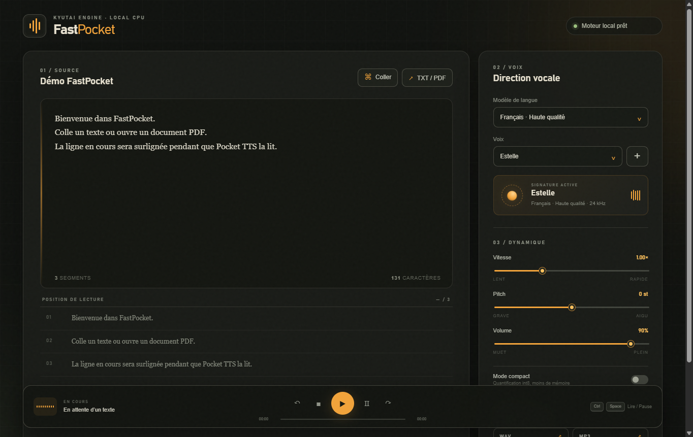
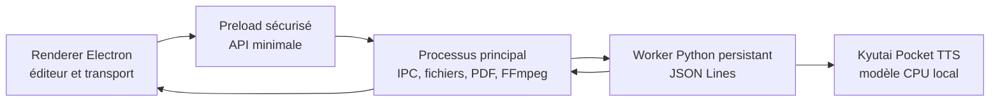

# FastPocket

### Le lecteur de documents local propulsé par Kyutai Pocket TTS

[](LICENSE)
[](https://github.com/arkcle83/FastPocket/actions/workflows/ci.yml)
[](https://nodejs.org/)
[](https://www.python.org/)
[](https://github.com/kyutai-labs/pocket-tts)

FastPocket est une application desktop Electron qui lit à voix haute le presse-papiers, les fichiers texte et les PDF. Tout fonctionne localement : aucun texte n’est envoyé vers une API TTS distante.



## Pourquoi FastPocket ?

Pocket TTS fournit un excellent moteur CPU, mais son interface de démonstration est pensée pour générer un extrait. FastPocket en fait un véritable lecteur de documents : lecture segmentée, pause, navigation, suivi visuel et export audio.

## Fonctionnalités

- Lecture depuis le presse-papiers, TXT, Markdown et PDF
- Six familles de langues : français, anglais, allemand, italien, espagnol et portugais
- Catalogue de voix Kyutai et échantillons personnalisés
- Pause, reprise, arrêt et navigation segment précédent/suivant
- Surlignage de la ligne ou phrase en cours
- Vitesse réglable de `0,65×` à `1,80×`
- Pitch indépendant de `-6` à `+6` demi-tons
- Volume en temps réel
- Export WAV et MP3 avec les réglages actifs
- Mode int8 pour réduire l’utilisation mémoire
- Interface Electron isolée : sandbox, `contextIsolation` et API preload minimale

## Installation rapide

### Prérequis

- [Node.js](https://nodejs.org/) 22 ou plus récent
- [uv](https://docs.astral.sh/uv/) pour l’environnement Python
- Windows, macOS ou Linux

```bash
git clone https://github.com/arkcle83/FastPocket.git
cd FastPocket
uv sync --no-dev
npm install
npm start
```

Le premier lancement télécharge les poids Pocket TTS et la voix sélectionnée depuis Hugging Face. Les lancements suivants utilisent le cache local.

> Pour utiliser une voix audio personnalisée, accepte les conditions du modèle Pocket TTS sur Hugging Face puis exécute `uvx hf auth login`. Les voix intégrées ne nécessitent pas de compte.

Consulte [le guide desktop](DESKTOP.md) pour le choix de Python, les raccourcis et le dépannage.

## Utilisation

| Action | Interface | Raccourci |
|---|---|---|
| Lire ou reprendre | Bouton `▶` | `Ctrl + Espace` |
| Mettre en pause | Bouton `Ⅱ` | `Ctrl + Espace` |
| Segment précédent | Bouton `↶` | `Alt + ←` |
| Segment suivant | Bouton `↷` | `Alt + →` |
| Arrêter | Bouton `■` | — |
| Ajouter une voix | Bouton `+` | — |

Le suivi est effectué par ligne ou phrase. Pocket TTS ne fournit pas encore d’alignement temporel mot-à-mot ; FastPocket ne simule donc pas de faux timing.

## Architecture



Le worker Python reste vivant afin de ne pas recharger le modèle à chaque segment. Electron précharge la ligne suivante pendant la lecture de la ligne courante. Plus de détails dans [le document d’architecture](docs/plans/2026-08-06-fastpocket-electron-design.md).

## Développement

```bash
uv sync
npm ci
npm run check
npm test
```

La suite desktop couvre la segmentation, l’extraction PDF et la persistance de configuration via le worker Python. Une synthèse réelle avec `english/alba` est également utilisée comme smoke test manuel avant publication.

Les contributions sont bienvenues : lis [CONTRIBUTING.md](CONTRIBUTING.md) avant d’ouvrir une pull request. Les vulnérabilités doivent suivre [SECURITY.md](SECURITY.md).

## Limites connues

- Le suivi est au niveau du segment, pas du mot.
- Le changement de pitch s’applique au prochain segment généré.
- Pocket TTS n’est pas thread-safe ; les synthèses sont sérialisées.
- Le clonage vocal dépend de l’accès Hugging Face aux poids correspondants.

## Crédits et licence

FastPocket est construit sur [Kyutai Pocket TTS](https://github.com/kyutai-labs/pocket-tts). Le moteur, les modèles et les voix restent soumis à leurs licences et conditions d’utilisation respectives. Consulte [NOTICE.md](NOTICE.md) pour l’attribution.

Le code de ce dépôt est distribué sous licence [MIT](LICENSE). N’utilise jamais le clonage vocal sans le consentement explicite de la personne concernée.
